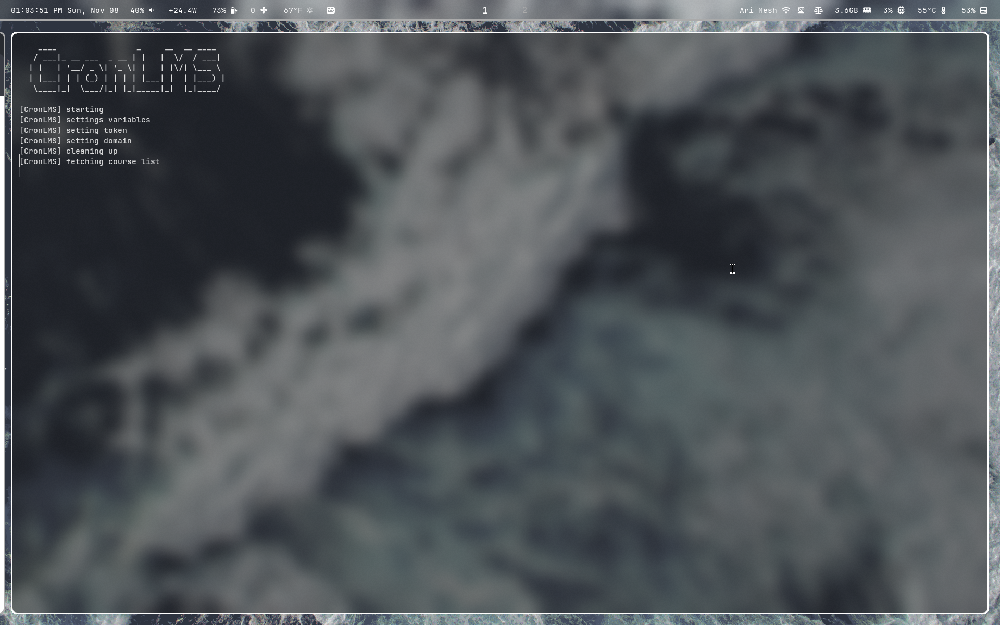
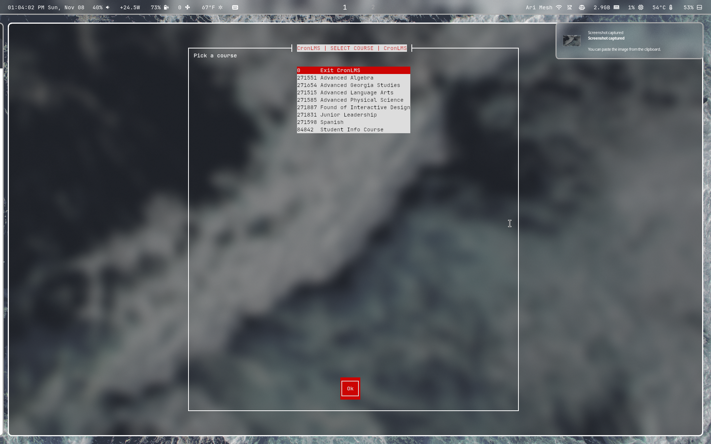
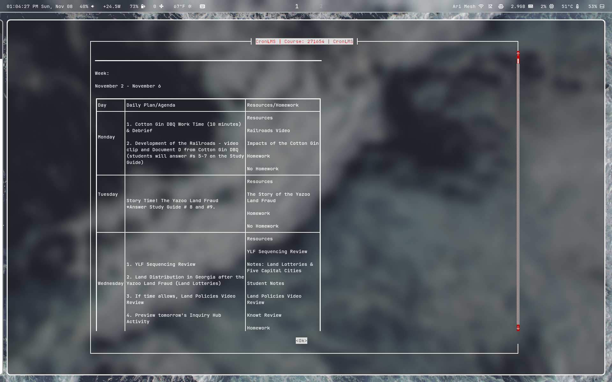
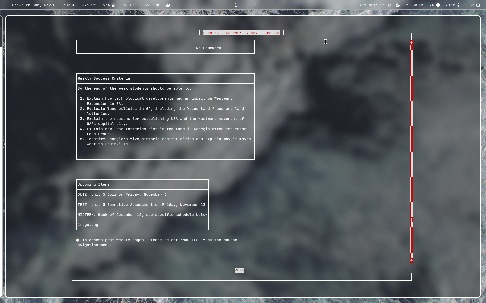

# CronLMS
### About
**CronLMS** is a TUI application that lets users **view their canvas courses through a Linux terminal**. The script is written in **Bash** and can be ran on almost any Linux distribution.
*ChronLMS is not affiliated nor connected with Canvas LMS and exists as a separate entity*

### Precautions 
- **Access tokens are dangerous, if someone has your access token, they have full access to your Canvas.**
- To use CronLMS, you must have an **Access Token**, placed inside of the **token.txt** file. An Access Token **is not a browser cookie**. Cookies are temporary, and last only a **few hours**.
- When whiptail is used, Ive added transparency flags to make it look better, these **may** cause artifacts or unclear text if ran on a terminal emulator other than [kitty](https://sw.kovidgoyal.net/kitty/)

### Screenshots
<p align="center">
  
  
</p>
<p align="center">
  
  
</p>

### Get an Access Token
There are multiple ways to get a canvas **access token**, The safest and most reliable is to use the **Create Access Token Button** through your canvas settings. 
Some schools may blocked this, meaning you have to choose another way to gain it, or ask an administrator. Here are the following ways to **get an access token safely**.
- Generate an access token through **official canvas** (easiest)
- Use a waydroid machine and **intercept the token** with **mitmproxy** from the android app (moderate)
- Do whatever [this guy is doing](https://tsun1031.xyz/posts/retrieving-instructure-canvas-lms-token)

### Install Dependencies
**CronLMS** Uses the following dependencies
- curl
- w3m
- jq
- sed
- whiptail
- coreutils

**Debian/Ubuntu**
```
sudo apt update && sudo apt install -y curl jq w3m whiptail
```

**Fedora/RHEL/CentOS**
```
sudo dnf install -y curl jq w3m newt
```

**Arch/Manjaro**
```
sudo pacman -Syu --needed curl jq w3m libnewt
```

**OpenSUSE**
```
sudo zypper install -y bash curl jq w3m newt
```

**Dependency Problems**
- In RHEL or CentOS, you might need to [enable epel](https://www.redhat.com/en/blog/install-epel-linux).
- Older RHEL or CentOS version use **yum**, ``sudo yum install -y curl jq w3m newt``.
- OpenSUSE May require a refresh, ``sudo zypper refresh``.

